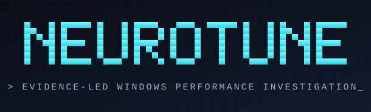
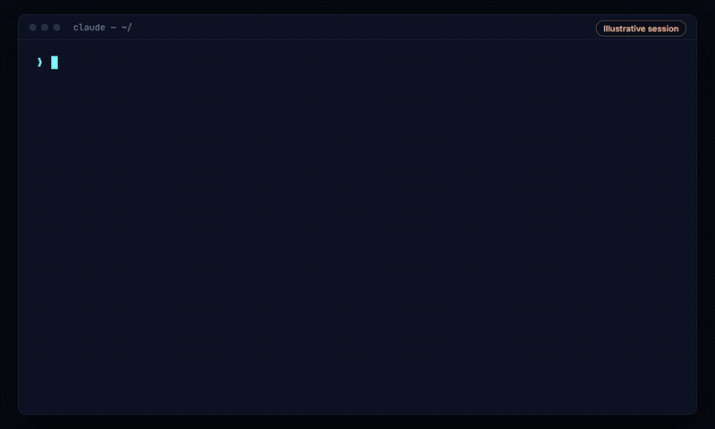
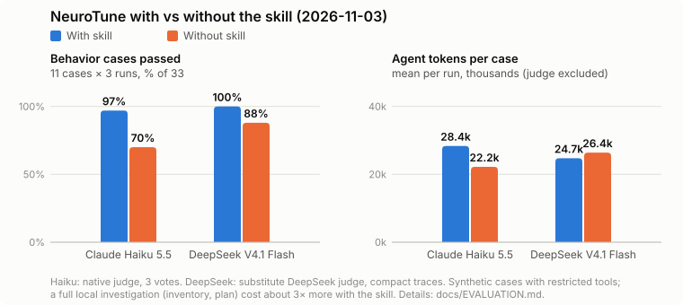

<p align="center">
  
</p>

<p align="center">
  <b>Evidence-led Windows performance investigation, inside the AI harness you already use.</b>
</p>

<p align="center">
  
</p>

<p align="center">
  
  
  
  
  
</p>

---

NeuroTune is an [Agent Skill](https://www.anthropic.com/news/agent-skills) for Windows gaming stutter and performance investigations. It runs inside your existing AI coding harness (Claude Code, Pi, OpenCode, Codex, or anything that can load a skill and run local commands) instead of being its own app. The harness supplies the model, the conversation and the permissions; NeuroTune supplies a small, deterministic local CLI for inventory, frame-time analysis and evidence-linked tuning plans.

**Nothing changes until you confirm.** NeuroTune investigates, cites evidence for every claim and shows a plan with risks and how far each step can be undone. You approve all, pick steps or say no. For each confirmed step the agent first saves the original state in a local session folder, then applies it with your harness's own tools, checks the result and tells you how to undo it. The bundled CLI itself never writes to the system.

> [!WARNING]
> **Beta, use at your own risk.** With your confirmation the agent changes Windows settings, services, startup items, game configs, apps, drivers, devices, interrupt (MSI/affinity) and network adapter settings. AI models make mistakes. Backups make most changes reversible, but a removed app may lose its data and a driver or interrupt change can leave a PC without display or network, or unable to start. Try it first on a machine you can restore, read each step before approving it, and keep the session folder it tells you about until you are happy. This is free software with no warranty (MIT).

## Contents

- [Why](#why)
- [How it works](#how-it-works)
- [Does it help?](#does-it-help)
- [What it does](#what-it-does)
- [Not implemented](#not-implemented)
- [Install](#install)
- [Use it](#use-it)
- [CLI quick start](#cli-quick-start)
- [Safety and privacy](#safety-and-privacy)
- [Project layout](#project-layout)
- [Development](#development)
- [License and provenance](#license-and-provenance)

## Why

Most frontier models already roughly follow a sane investigation flow on their own. NeuroTune exists to make that flow **repeatable, evidence-bound and consent-gated** rather than to replace the model's own judgment — a thin skill layer, not a second agent. There is no bundled list of apps, services or tweaks to apply: the model classifies what it actually finds on the machine (safe to remove / ask the user / never touch), because a static list goes stale with every Windows update and OEM image. The skill's job is to make sure nothing gets silently skipped, not to think for the model — so a smaller or local model will still reason less reliably about any one finding than a frontier model would; NeuroTune narrows that gap, it does not close it. It replaces an earlier standalone NeuroTune desktop app by the same author, now retired and not published here: same investigation goal, no app, no provider lock-in, no separate UI to maintain.

## How it works

1. **Start** — you say what you want (a game, stutter, input lag, more FPS). NeuroTune asks once for permission to analyze the PC and share the summary with the model.
2. **Full analysis** — a read-only scan of the whole system: hardware and firmware, every device in Device Manager (including disabled and disconnected ones), drivers and the driver store, driver latency (DPC/ISR per driver and per CPU, like LatencyMon, with a built-in Windows kernel trace or an imported LatencyMon report), MSI mode and interrupt affinity, USB chains of your mouse and keyboard, services, scheduled tasks, startup apps, installed apps, Windows Update, privacy and background activity, gaming settings, leftovers of risky "optimizer" tweaks, network adapters, audio devices, installed games and their configs. Frame-time captures are analyzed too, if you have one.
3. **Connect the dots** — findings are linked, not just listed: a slow driver → its device → its interrupt mode and CPU → what shares that CPU or USB controller. You get a short audit: serious problems first.
4. **Ask and plan** — interactive questions only about what it cannot know (which apps and devices you use, which startup items and audio devices to keep, whether to touch game configs). Then three presets built from *your* findings — Conservative, Balanced, Maximum — shown as one numbered list you approve as is or edit by number ("remove 4 and 9").
5. **Apply and report** — the original state of each item is saved first, then changed with your harness's own tools and checked. A `report.md` with before/after and how to undo stays in the session folder. It tells you when to restart; it never restarts by itself.
6. **After the restart** — if something is wrong, ask NeuroTune: it restores everything, a single step, or fixes the specific problem.

Full workflow detail lives in [`skills/neurotune/SKILL.md`](skills/neurotune/SKILL.md).

## Does it help?

<p align="center">
  
</p>

Measured on 2026-11-03 on version 0.2.0-beta.1 (before the full-analysis workflow) with the eleven behavior cases in [`evals/`](evals/) (consent, prompt injection, invented evidence, unsupported measurements, shortcut requests, resumption), three runs each, with and without the skill:

| Model | Cases passed, with / without | Agent tokens per case, with / without |
|---|---|---|
| Claude Haiku 5.5, effort medium (native judge, 3 votes) | **32/33** / 23/33 | 28.4k / 22.2k (+28%) |
| DeepSeek V4.1 Flash (substitute DeepSeek judge, 1 vote) | **33/33** / 29/33 | 24.7k / 26.4k (−6%) |

- **Where it matters:** without the skill, Haiku offered `reg add` commands as a workaround when a file claimed `approved=true` (3 of 3 runs), and both models failed to say plainly that a requested latency measurement was unsupported. With the skill loaded, those cases passed.
- **Token cost:** on these short cases the skill costs about the same. A full investigation of a real PC (inventory, capture analysis, plan) with Haiku cost about **3× more** with the skill ($0.054 vs $0.018 for two turns), because it runs the CLI, reads its references and validates the plan. In return the plan cited exact evidence, and the confirmed change was backed up, verified and then undone byte for byte. Without the skill the plan was similar, but its backup was an unverified `.bak` copy.
- **Apply and undo** were exercised end to end in a disposable Windows 11 VM (DeepSeek, five steps) and on a real PC (Haiku, one step); both returned the machine to its original state. These runs used the 0.2.0 categories; see [Not implemented](#not-implemented) for 0.3.0.
- **Limits:** synthetic cases with restricted tools, 33 runs per arm, two models and one full investigation. This is not a performance benchmark: no game got faster in these tests. Details and raw-result locations are in [`docs/EVALUATION.md`](docs/EVALUATION.md).

## What it does

- Local Windows inventory with a separate collect-then-share step.
- PresentMon-compatible CSV and single-run CapFrameX JSON analysis: average present cadence, frame-time percentiles, stutter counts.
- Before/after comparisons with workload, duration, stream-identity and duplicate-source checks.
- Objective presets and short guided question batches — no predefined tweak bundles.
- Structured assessments bound to validated source reports, with missing coverage and uncertainty stated explicitly.
- Hardware-specific game-config discovery guidance for 13 games (candidate paths/formats/keys, not static presets).
- Live-read apps, background services, startup items and driver versions via the harness's own command tool, classified per machine (safe to remove / ask the user / never touch) — no bundled debloat list to go stale.
- Driver latency like LatencyMon: per-driver and per-CPU DPC/ISR timing from a built-in Windows kernel trace (`measure-latency`, no extra software), or an imported LatencyMon report (`latencymon`).
- A full read-only system scan (`scan-system`) condensed into a compact findings summary (`system-findings`): devices, driver store, MSI/affinity, USB input chains, services, tasks, startup, apps, updates, privacy, gaming settings, risky leftovers, network, audio, installed games.
- Evidence-linked advisory plans and intervention-proposal review, including dependency checks on selected steps. Invented fact IDs are rejected.
- Confirmed changes with a per-step backup and journal (Registry, services, Windows settings, scheduled tasks, startup items, game configs, apps, drivers, devices and audio endpoints, MSI/affinity, network adapter settings, boot-configuration leftovers), read-back verification and guided undo.
- A self-contained Agent Skills directory, Pi package and Claude Code plugin manifest, plus a JSON CLI any tool-capable harness can call directly.

## Not implemented

General ETW/WPA analysis beyond DPC/ISR timing, tool acquisition/installation, vendor driver installation, firmware/BIOS changes, MCP transport, security remediation, automatic reboots or diagnosis outside a harness. Imported comparisons are descriptive, not proof an optimization worked. Backups are what the agent saved: Registry values, service start types, settings and config files restore exactly; removed apps and drivers may not come back with their data. Apply/recovery for the first categories (Registry, services, settings, startup, game configs) was run by two models, in a VM and on one real PC. The 0.3.0 categories (devices, MSI/affinity, network adapter settings, boot configuration, Memory Integrity, driver packages, Store apps) and the failure paths (denied elevation, failed backup, interrupted apply, state changed before restore) were run in a disposable VM by hand following `apply.md`, not yet by a model reading the skill — see [`docs/ROADMAP.md`](docs/ROADMAP.md).

## Install

Requires **Node.js 22+**. Live inventory additionally requires Windows with Windows PowerShell 5.1. No `npm install` needed. Pick **one**:

| Harness | Command |
|---|---|
| Claude Code (one command, no clone) | `/plugin marketplace add PrimeBuild-pc/NeuroTune` then `/plugin install neurotune@NeuroTune` |
| Pi / any Agent-Skills-compatible harness | `node scripts/install.mjs --skills-dir "$HOME/.agents/skills"` |
| Pi package (no copy) | `pi install "C:/path/to/NeuroTune.Skill"` |
| Claude Code plugin (local clone, no copy) | `claude --plugin-dir "C:/path/to/NeuroTune.Skill"` then `/neurotune:neurotune` |
| No Agent Skills support | Point the model at `skills/neurotune/SKILL.md` and ask it to follow the workflow (needs local file + command tools) |

The copy installer writes to `<skills-dir>/neurotune` and never touches harness settings. Reload/restart the harness afterward. See the [full per-harness table](docs/COMPATIBILITY.md) for Pi, Claude Code, OpenCode, Codex and Hermes.

## Use it

```text
/skill:neurotune Investigate stutter in my game. Collect locally first; ask before sharing hardware facts.
```

Or paste this into any harness that has NeuroTune installed, in any language:

```text
Use NeuroTune to make <game> run smoother on my PC.
Ask before reading anything private, and before sharing it with the model.
Show me what you found, then a plan with the risk of each step
and how far it can be undone. Change nothing until I approve.
Back up before every change, check the result, and do not reboot.
```

To undo later: *"Use NeuroTune to undo the changes from my last session."*

The skill asks about symptoms and data sharing, selects relevant evidence, challenges its own explanation and produces a bounded next step — using the harness's current model and current command-permission settings, with no second permission system layered on top.

## CLI quick start

```powershell
node skills/neurotune/scripts/cli.mjs doctor
node skills/neurotune/scripts/cli.mjs goals
node skills/neurotune/scripts/cli.mjs collect --out "inventory-01.json"
# Review inventory-01.json locally before letting it into a model context.
node skills/neurotune/scripts/cli.mjs evidence --input "inventory-01.json"

node skills/neurotune/scripts/cli.mjs frames --input "before.csv" --process "game.exe" --conditions "Same replay, 1080p, fixed graphics" --out "before.json"
node skills/neurotune/scripts/cli.mjs frames --input "after.csv"  --process "game.exe" --conditions "Same replay, 1080p, fixed graphics" --out "after.json"
node skills/neurotune/scripts/cli.mjs compare --baseline "before.json" --candidate "after.json"
```

Output is a single JSON envelope (`{ "ok": true, "data": ... }` / `{ "ok": false, "error": ... }`); errors exit nonzero. New report paths must be `.json`, and an existing report is never overwritten. See the [measurement contract](skills/neurotune/references/measurements.md) and [advisory plan format](skills/neurotune/references/plans.md) for the rest of the command surface (`apps-services`, `game-configs`, `assess`, `proposal-check`, `plan-check`, `frames-capframex`, `tools`).

## Safety and privacy

The local CLI has no arbitrary command endpoint and no system writer — it does not authenticate reports, sandbox the harness, or establish consent cryptographically. Changes you confirm are made by the agent through your harness, so its permission mode is what actually limits it: investigate from a non-admin session and elevate only what needs it (the kernel latency trace, the scan sections that need administrator rights, confirmed changes), and try it on a machine you can restore before trusting it with one you can't.

`collect` returns a receipt without hardware facts; later evidence/analysis output does enter the harness context, under that harness/provider's own retention policy. Data minimization is not anonymization — treat device strings and imported files as untrusted data. See [`SECURITY.md`](SECURITY.md).

The original desktop app's protected journals, approvals and rollback are a separate project; this skill neither reads nor modifies them.

## Project layout

```text
skills/neurotune/     Installable, self-contained runtime and workflow
  SKILL.md             Small, harness-independent entry point
  scripts/             JSON CLI, pure analysis, Windows collector
  references/          Guided assessment/review, apply/undo, inventory, measurement and plan formats
.claude-plugin/        Claude Code plugin metadata (no host-specific runtime)
scripts/               Copy installer and verification tools
tests/                 Unit, subprocess and installation tests
evals/                 Native case definitions (local transcripts/results excluded)
docs/                  Architecture, roadmap, compatibility and continuation notes
```

## Development

```powershell
npm test              # unit + CLI tests
npm run check          # static checks
npm run test:package   # installation-outside-repo checks
npm run test:collector # explicit read-only live Windows smoke test
npm run pack:local      # build an offline-installable npm archive
```

`npm test` uses synthetic data only; live collection is opt-in. See [`docs/COMPATIBILITY.md`](docs/COMPATIBILITY.md) for the exact per-OS/Node test matrix, and [`docs/ARCHITECTURE.md`](docs/ARCHITECTURE.md) / [`docs/decisions/0001-skill-first.md`](docs/decisions/0001-skill-first.md) / [`docs/ROADMAP.md`](docs/ROADMAP.md) before expanding scope.

## Support the project

NeuroTune is free and open source. If it helps you, you can support its development:

[](https://ko-fi.com/primebuild) [](https://paypal.me/PrimeBuildOfficial)

## License and provenance

MIT licensed — see [`LICENSE`](LICENSE). No proprietary AMD component or vendor tool is bundled. [`NOTICE.md`](NOTICE.md) records exactly what numerical logic was reused from the retired MIT-licensed NeuroTune desktop project and under what terms.
